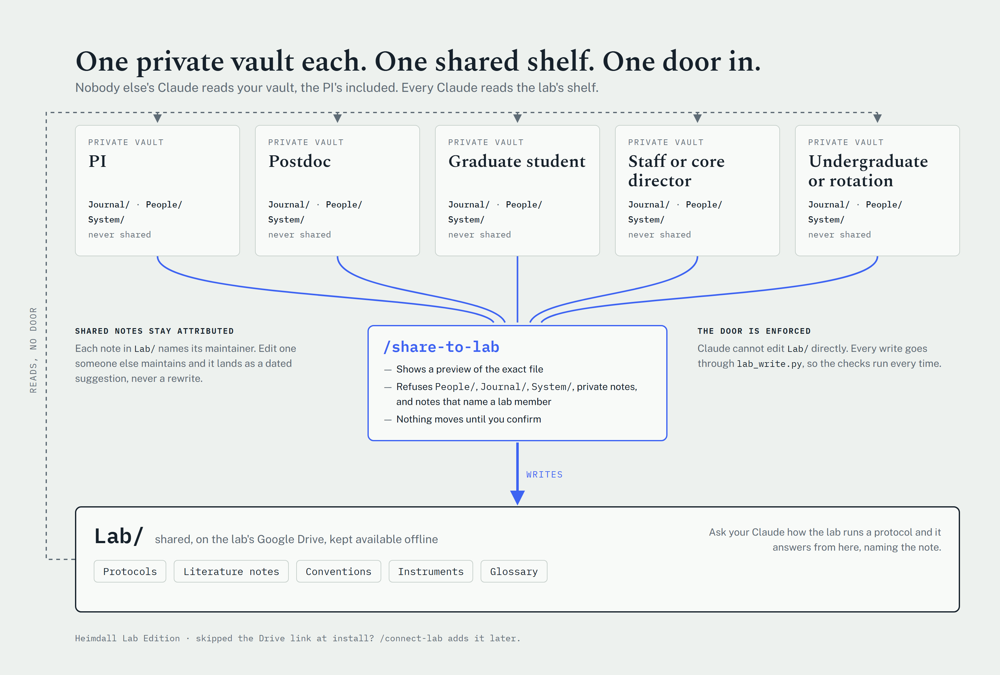
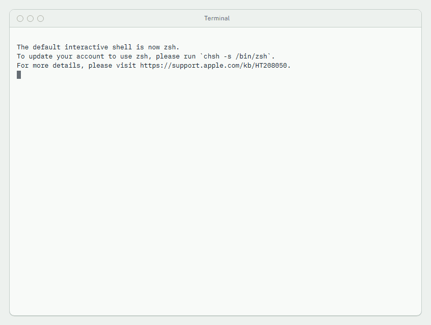
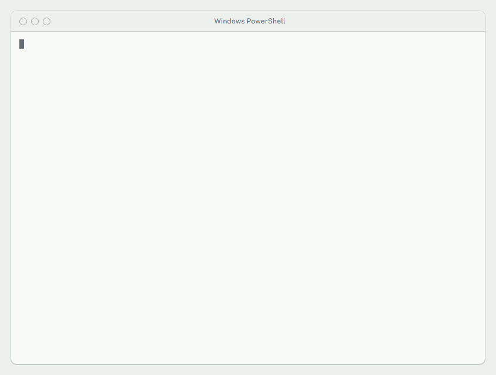
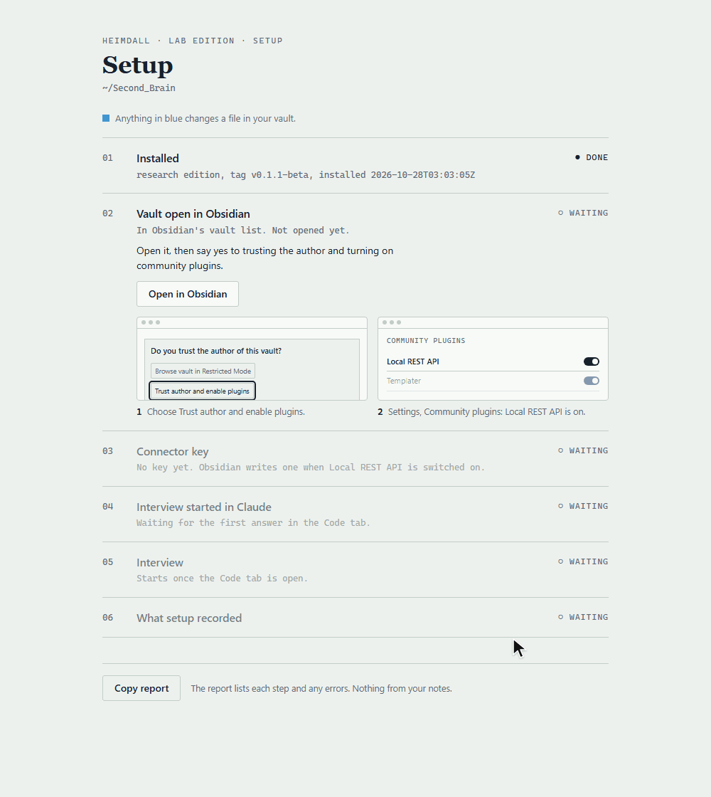
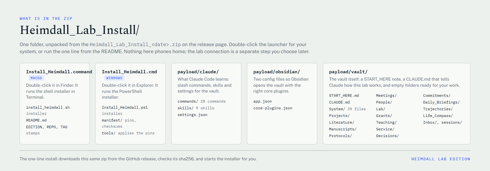

# Heimdall Lab Edition (beta)

[](https://github.com/bradykrowe/Heimdall-Research_Edition/actions/workflows/install.yml)

The badge runs the install on a fresh macOS and Windows machine on GitHub,
including the software step. It can't test the GUI steps, the password
prompt, a Mac without Command Line Tools, or your lab's sync client.

Heimdall Lab Edition sets up a second brain for a scientist. You get an
Obsidian vault with folders laid out for lab work, a set of commands for
Claude Code, and a short setup interview so Claude knows who you are at the
start of every session.

Everything stays on your computer. The vault is a folder of plain markdown
files. The only thing that leaves is your conversation with Claude, which goes
to Anthropic to run the model. The README inside the zip covers this in more
detail before you install.

Everyone in the lab gets their own private vault. The lab shares one folder,
`Lab/`, which Claude checks first for lab questions. Notes only get into it
through `/share-to-lab`, which shows you the file first and won't share
anything private.

<picture>
  <source media="(prefers-color-scheme: dark)" srcset="docs/img/lab_layer_dark.png">
  
</picture>

## Install

You need a Claude account with Claude Code: a Pro, Max or Team seat, or an
API key. Claude Code asks you to sign in the first time it starts.

### macOS

Paste this into Terminal. It downloads the release, checks the file hash,
unzips it and starts the installer. [get.sh](get.sh) is short and commented if
you want to read it first.

```bash
curl -fsSL https://raw.githubusercontent.com/bradykrowe/Heimdall-Research_Edition/v0.1.2-beta/get.sh | bash
```

This has to be one line. If your email split it in two, join it back together
before you press Return.

<picture>
  <source media="(prefers-color-scheme: dark)" srcset="docs/img/install_mac_dark.gif">
  
</picture>
The install on a clean Mac, recorded on a GitHub macOS runner. The questions are the same on both systems.

The installer asks where to put the vault. Press Return for `~/Second_Brain`,
or type a different folder (you can drag one in from Finder). If you already
have a vault or the software, those steps get skipped and nothing of yours is
overwritten.

If your Mac is managed by IT and you aren't an administrator, the script will
tell you and stop before it installs anything. Ask IT to install Obsidian,
Node.js, Python 3.12 and Claude Code, then run the same line with
`bash -s -- --skip-software` added to the end.

### Windows

Paste this into PowerShell. [get.ps1](get.ps1) is there if you want to read it
first.

```powershell
irm https://raw.githubusercontent.com/bradykrowe/Heimdall-Research_Edition/v0.1.2-beta/get.ps1 | iex
```

<picture>
  <source media="(prefers-color-scheme: dark)" srcset="docs/img/install_windows_dark.gif">
  
</picture>
The same install on a fresh Windows profile. The window stays open at the end with the next step printed.

You may see a SmartScreen warning because the scripts aren't code-signed.
Click More info, then Run anyway.

### By hand

Download the zip and its `.sha256` file from the
[release page](https://github.com/bradykrowe/Heimdall-Research_Edition/releases/tag/v0.1.2-beta),
check the hash, unzip, and double click `Install_Heimdall.cmd` (Windows) or
`Install_Heimdall.command` (macOS). The README in the zip explains the
Gatekeeper and SmartScreen prompts.

## After the install

The installer finishes by opening a setup window in your browser. It runs on
your computer and doesn't connect to the internet. It lists the steps left and
checks each one off as you go:

1. Open the vault in Obsidian. Your vault is already in the list. Say yes when
   Obsidian asks to turn on community plugins.
2. Add the connector key. The window can read the Local REST API key from
   Obsidian and save it to `System/secrets/obsidian.env` with one click, or
   you can paste it in. The key stays on your computer.
3. Open the vault folder in the Claude desktop app's Code tab and type
   `/setup`. The window follows along as you answer. The first five
   questions take about ten minutes; the rest, about 20, can wait.

<picture>
  <source media="(prefers-color-scheme: dark)" srcset="docs/img/onboard_setup_dark.gif">
  
</picture>
The setup window from start to finish, recorded against a demo vault.

If you closed the window, run `python3 System/bin/onboard/server.py` (macOS)
or `python System\bin\onboard\server.py` (Windows) from the vault folder to
open it again. `START_HERE.md` in the vault has the same steps written out,
including how to do each one without the window. After that, drop a PDF into
`Literature/` and run `/paper`.

## What's in the zip

<picture>
  <source media="(prefers-color-scheme: dark)" srcset="docs/img/zip_contents_dark.png">
  
</picture>

| Part | What |
|---|---|
| `Install_Heimdall.cmd`, `Install_Heimdall.command` | Double-click launchers |
| `Install_Heimdall.ps1`, `install_heimdall.sh` | The installers, plain text with comments |
| `payload/vault/` | The starter vault: Lab, Literature, Projects, Manuscripts, Grants, Teaching, Service, People and system folders, with templates |
| `payload/claude/commands/` | 29 commands, including `/paper`, `/protocol` and `/today` |
| `payload/claude/skills/` | 8 skills |
| `manifest/plugins.json` | The Obsidian plugins it installs, grouped by tier, with what each is for |

## Beta

This is a beta for one research group. The Windows install has been tested
start to finish. On macOS, the vault, plugin and connector steps have been
tested on a real Mac, but the software step (Homebrew, Node, Python, Claude
Code) hasn't been run on an Apple silicon Mac yet. The README in the zip lists
the other known issues.

New versions come out as tagged releases. Until there's an update command, you
can install a new release over the old one by pointing the installer at your
existing vault. It adds anything missing and leaves your files alone.

## Reporting a problem

Open an issue with the command that failed and what it printed. Don't paste
vault text, your API key, or anything from `System/secrets/`. Everything runs
on your computer, so nobody needs your vault to fix a bug.

## Data

Don't put human-subjects data, patient material, donor information, or
anything covered by an IRB protocol or data use agreement in the vault. The
starter settings tell Claude the same thing. Keep a pointer to where the data
lives instead.

## License

Source available for use inside your own research group. See [LICENSE.md](LICENSE.md).
